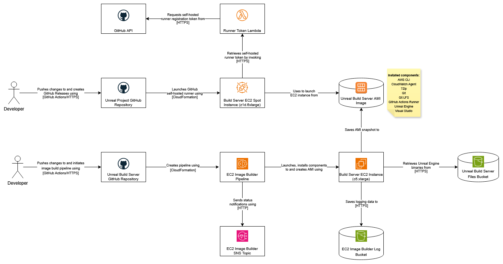

# Unreal Build Server Image

Builds an EC2 Image Builder AMI for an Unreal Engine build server

## Architecture



## Required IAM roles:

- AmazonS3FullAccess
- AWSCloudFormationFullAccess
- AWSLambda_FullAccess

## Required IAM policy:

```
{
	"Version": "2012-10-17",
	"Statement": [
		{
			"Sid": "PublishToSNS",
			"Effect": "Allow",
			"Action": "SNS:Publish",
			"Resource": "*"
		},
		{
			"Sid": "ManageIAM",
			"Effect": "Allow",
			"Action": [
				"iam:CreateInstanceProfile",
				"iam:DeleteInstanceProfile",
				"iam:GetRole",
				"iam:GetInstanceProfile",
				"iam:TagRole",
				"iam:RemoveRoleFromInstanceProfile",
				"iam:DeletePolicy",
				"iam:CreateRole",
				"iam:DeleteRole",
				"iam:AttachRolePolicy",
				"iam:PutRolePolicy",
				"iam:AddRoleToInstanceProfile",
				"iam:CreatePolicy",
				"iam:DetachRolePolicy",
				"iam:DeleteRolePolicy",
				"iam:GetRolePolicy"
			],
			"Resource": "*"
		},
		{
			"Sid": "CreateServiceLinkedRole",
			"Effect": "Allow",
			"Action": "iam:CreateServiceLinkedRole",
			"Resource": "arn:aws:iam::*:role/aws-service-role/://amazonaws.com",
			"Condition": {
				"StringLike": {
					"iam:AWSServiceName": "spotfleet.amazonaws.com"
				}
			}
		},
		{
			"Sid": "SpotFleetPassRole",
			"Effect": "Allow",
			"Action": "iam:PassRole",
			"Resource": "*",
			"Condition": {
				"StringEquals": {
					"iam:PassedToService": [
						"ec2.amazonaws.com",
						"ec2.amazonaws.com.cn"
					]
				}
			}
		},
		{
			"Sid": "ManageImageBuilder",
			"Effect": "Allow",
			"Action": [
				"imagebuilder:DeleteDistributionConfiguration",
				"imagebuilder:GetComponent",
				"imagebuilder:GetImagePipeline",
				"imagebuilder:UpdateDistributionConfiguration",
				"imagebuilder:DeleteComponent",
				"imagebuilder:GetImageRecipe",
				"imagebuilder:StartImagePipelineExecution",
				"imagebuilder:CreateImageRecipe",
				"imagebuilder:CreateDistributionConfiguration",
				"imagebuilder:GetDistributionConfiguration",
				"imagebuilder:DeleteInfrastructureConfiguration",
				"imagebuilder:CreateInfrastructureConfiguration",
				"imagebuilder:GetImage",
				"imagebuilder:CreateImagePipeline",
				"imagebuilder:GetInfrastructureConfiguration",
				"imagebuilder:CreateComponent",
				"imagebuilder:DeleteImagePipeline",
				"imagebuilder:DeleteImageRecipe",
				"imagebuilder:UpdateInfrastructureConfiguration"
			],
			"Resource": "*"
		},
		{
			"Sid": "ManageSecretsManager",
			"Effect": "Allow",
			"Action": [
				"secretsManager:DeleteSecret",
				"secretsManager:UpdateSecret",
				"secretsmanager:GetSecretValue",
				"secretsmanager:CreateSecret"
			],
			"Resource": "*"
		}
	]
}
```

## Related writing

I wrote about this repository on my blog:
- [Automated Unreal Engine Build Server on AWS Part 1: Base AMI](https://blog.maceage.com/posts/2026/automated-unreal-engine-build-server-on-aws-1/)
- [Automated Unreal Engine Build Server on AWS Part 2: Unreal AMI](https://blog.maceage.com/posts/2026/automated-unreal-engine-build-server-on-aws-2/)
- [Automated Unreal Engine Build Server on AWS Part 3: Build](https://blog.maceage.com/posts/2026/automated-unreal-engine-build-server-on-aws-3/)